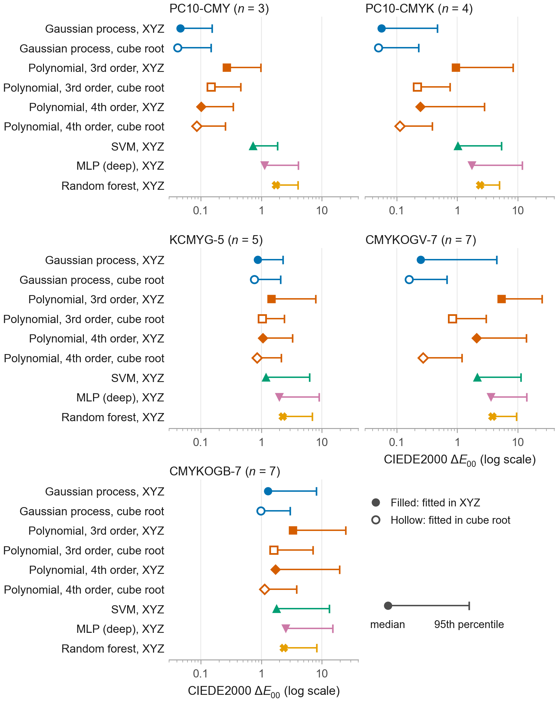

# AI and Machine Learning Methods for n-Colorant Printer Characterization

Code and data for the paper published in *Technologies* (MDPI), 2026, open access:
[mdpi.com/2227-7080/14/10/684](https://www.mdpi.com/2227-7080/14/10/684)
(DOI 10.3390/technologies14100684).

## Summary

We compare 13 machine learning methods with polynomial regression for printer color
characterization (ink amounts to XYZ). We use nine datasets with three to seven colorants and 13
newsprint press runs, and measure errors with CIEDE2000 (ΔE00).
- **Main comparison (every model fitted in XYZ):** Gaussian process regression has the lowest
  median error on all nine datasets.
- **Fitted in a cube-root space:** a polynomial of degree 4 comes within a factor of 1.1 to 1.7 of
  it on the five- and seven-ink sets.
- **Overall:** the Gaussian process is the most reliable fixed configuration, but not always the
  best.



*Figure 4 of the paper: median, 95th percentile and maximum ΔE00 per model, one panel per dataset.*

## Reproduce

Start with [`journal/REPRODUCE.md`](journal/REPRODUCE.md). It covers the environment, the data,
and how to rebuild every table and figure of the paper from the results CSVs.

## What is where

- [`journal/pipeline/`](journal/pipeline/): the pipeline (one code path for 3, 4, 5 and 7
  colorants), including the table builder that checks every table cell against its CSV.
- [`journal/results/`](journal/results/): every results CSV behind the paper's tables.
- [`journal/figures/`](journal/figures/): the scripts that draw each figure from the CSVs.
- [`docs/DATA.md`](docs/DATA.md): the datasets. PC10, PC11, FOGRA51 and CMYKOGV-7 are public. The
  newsprint runs, KCMYG-5 and CMYKOGB-7 are restricted and are not in this repository.
- `main/`, `input/`, `utils/`: the earlier conference version (see below).

## Citation

> Zafar, M.H.; Green, P. AI and Machine Learning Methods for n-Colorant Printer
> Characterization. *Technologies* **2026**, *14*, 684.
> https://doi.org/10.3390/technologies14100684

```bibtex
@article{zafar2026ncolorant,
  author  = {Zafar, Muhammad Hamza and Green, Phil},
  title   = {{AI} and Machine Learning Methods for $n$-Colorant Printer Characterization},
  journal = {Technologies},
  year    = {2026},
  volume  = {14},
  number  = {10},
  pages   = {684},
  doi     = {10.3390/technologies14100684},
  url     = {https://www.mdpi.com/2227-7080/14/10/684}
}
```

GitHub also offers a "Cite this repository" button (from [`CITATION.cff`](CITATION.cff)).
The code state at acceptance is the tag `technologies2026-accepted`.

## License

The code is MIT-licensed (see [`LICENSE`](LICENSE)). The datasets are not covered by it; their
sources and terms are in [`docs/DATA.md`](docs/DATA.md).

## Earlier conference version

An earlier version of this work was presented at AIC 2025. Its code is in `main/`, and its
published state is the git tag [`aic2025-published`](../../tree/aic2025-published). The error
values in that version were later corrected, and the journal paper is a new analysis.
